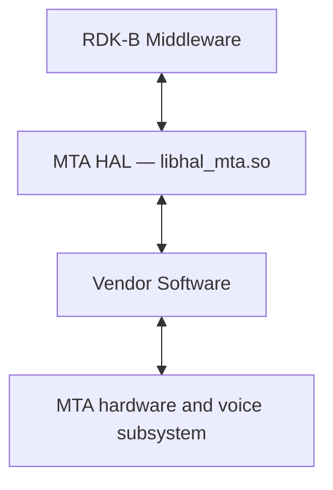
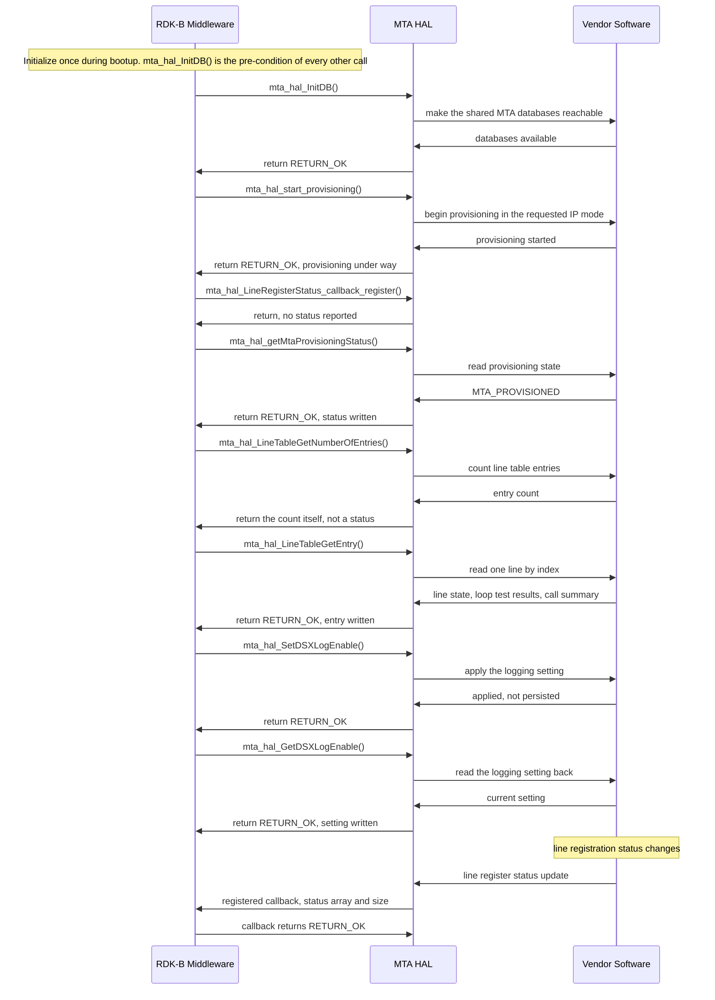

# MTA HAL Documentation

## Version History

| Date | Comment | Version |
| --- | --- | --- |
| 2024-01-29 | `RDKB-52497` — initial release of the MTA HAL interface definition, migrated to GitHub. | 1.0.0 |
| 2024-02-02 | `BD-1247` — `build_ut.sh` corrected. No interface change. | 1.0.1 |
| 2024-02-07 | Interface correction release: missing semicolon on the `MTAMGMT_MTA_CALLS` structure in `mta_hal.h`, plus a further header update. | 1.1.0 |
| 2026-08-24 | Rewritten against the canonical `HAL` specification topic set. Page renamed from `MTAhalSpec.md` to [halSpec.md](halSpec.md). Added `Version History`, `Optional Components`, `Data Structures and Defines`, `API Surface` and `State Diagram`; every one of the 49 declared functions is now named; the asynchronous notification callback is documented for the first time, correcting the previous claim that this interface has none; the sequence diagram now uses declared identifiers only. | 1.1.1 |

## Acronyms

- `API` \- Application Programming Interface
- `DECT` \- Digital Enhanced Cordless Telecommunications
- `DHCP` \- Dynamic Host Configuration Protocol
- `DHCPv6` \- Dynamic Host Configuration Protocol for IPv6
- `DOCSIS` \- Data Over Cable Service Interface Specification
- `DSX` \- Digital Signal Cross-connect
- `GR909` \- Telcordia GR-909 loop diagnostic test suite
- `HAL` \- Hardware Abstraction Layer
- `MTA` \- Media Terminal Adapter
- `OEM` \- Original Equipment Manufacturer
- `PIN` \- Personal Identification Number
- `QoS` \- Quality of Service
- `RDK-B` \- Reference Design Kit for Broadband Devices
- `SLA` \- Service Level Agreement
- `TN` \- Telephone Number

## Description

The diagram below describes the high-level software architecture in which this interface sits.

The MTA HAL is the abstraction layer through which RDK-B drives a Media Terminal Adapter — the part
of a broadband device that delivers home phone service over `DOCSIS` alongside high-speed internet.
It abstracts the underlying MTA hardware and the vendor voice software behind one standard set of
functions.

This repository carries the **interface definition only**: `mta_hal.h` declares 49 functions, the
data types they exchange and the status values they report. Each vendor or `OEM` ships its own
implementation behind that contract as a shared library.

**Caller.** No single dedicated middleware service owns this interface. The caller, shown as
RDK-B Middleware in the diagrams, is the RDK-B middleware component that links `libhal_mta.so`; it
is responsible for the initialization order described under `Initialization and Startup`.

The interface covers seven functional areas:

- **Initialization and provisioning** — make the shared MTA databases available locally, start IP
  provisioning in `IPv4`, `IPv6` or dual-stack mode, and read provisioning, configuration-file and
  `DHCP` progress.
- **Lines, telephone numbers and registration status** — the line table, per-line state and
  loop-test results, per-line registration status by poll or callback, and the line reset count.
- **`DECT` handsets** — enable the cordless subsystem, control the registration window, deregister
  a handset, read the base station's identity, get and set its authentication `PIN`, and list the
  registered handsets.
- **Calls and call processing** — per-call voice-quality records, call-processing state, and the
  `DOCSIS` service flows in use with their `QoS` parameters.
- **`DSX` and call-signalling logs** — read, enable, disable and clear the `DSX` and call-signalling
  logs, and read the MTA event log.
- **Battery** — presence, capacity, charge, run time, power source, condition, identity and
  power-saving mode of the backup battery.
- **Diagnostics and device maintenance** — start the `GR909` loop tests on a line, reset the device,
  and read the MTA reset count.

## Optional Components

Two parts of this interface depend on hardware a deployment may not have. All other parts are
mandatory.

- **The backup battery and its twelve calls.** The battery calls do not distinguish an absent
  battery from any other failure, so a caller calls `mta_hal_BatteryGetInstalled` first and treats
  its answer, not a failed capacity or status read, as the presence test.
- **The `DECT` cordless subsystem and its nine calls.** It is switched at run time through
  `mta_hal_DectGetEnable` and `mta_hal_DectSetEnable`; a deployment with the subsystem disabled or
  absent uses none of the other `DECT` calls. `DECT_MAX_HANDSETS` limits the handset population
  to 5.

## Component Runtime Execution Requirements

The requirements in this block apply to every implementation of this interface.

### Initialization and Startup

A caller makes these two calls once during bootup, in this order, before it relies on any other
entry point:

- `mta_hal_InitDB()` \- makes the shared MTA databases available locally. It is the pre-condition of
  every other call in the interface.
- `mta_hal_start_provisioning()` \- starts IP provisioning for all voice lines in the requested
  address mode, with the `DHCP` option 122 and option 2171 values to use. `RETURN_OK` means
  provisioning has started, not that the lines are provisioned.

Provisioning progress is polled through `mta_hal_getMtaProvisioningStatus()`,
`mta_hal_getConfigFileStatus()`, `mta_hal_getDhcpStatus()` and
`mta_hal_getMtaOperationalStatus()`. A caller that wants line registration updates registers its
callback after `mta_hal_InitDB()` succeeds and before the events it needs can occur, because
earlier status changes are not delivered; see `Asynchronous Notification Model`.

The interface has no de-initialization call. The shared databases stay available for the lifetime
of the process, and cleanup happens at process termination.

Third-party vendors implement this sequence to meet their operational requirements; its blocking
behaviour is described under `Blocking calls`.

### Threading Model

**The interface is not thread-safe.** Any module invoking an MTA HAL function serialises its calls
and completes `mta_hal_InitDB()` before issuing any other call from any thread. A caller must not
carry an assumption of thread safety over from another RDK-B HAL.

Vendors may create internal threads and event mechanisms to meet their operational requirements.
Those mechanisms synchronize between calls and events and release their own resources on closure.

The notification callback is invoked by the implementation and protects any state it shares with
the caller's own threads; see `Asynchronous Notification Model`.

### Process Model

All functions are expected to be called from multiple processes. Vendors protect their
implementations against two processes calling the same function simultaneously, to preserve data
integrity and prevent race conditions.

The caller's serialisation obligation under `Threading Model` spans processes: each call is
serialised against every other MTA HAL call, including calls made from another process. Where more
than one RDK-B component links this library, those components coordinate their calls.

### Memory Model

The caller allocates and releases the memory it passes to the interface. Vendors may allocate memory
for their own operational requirements and release it internally. Per-call ownership is documented
on each declaration in `mta_hal.h`.

#### Caller Responsibilities

- **Allocate before the call.** Allocate every output scalar, buffer and structure before the call
  and pass a non-NULL pointer.
- **Respect buffer bounds.** Size text buffers to the bounds the interface declares, and pass the
  buffer length where the call takes one.
- **Do not free implementation memory.** Do not free or keep the arrays returned through
  pointer-to-pointer out-parameters, or the memory reached through the `pCalls` and `pDescription`
  members; copy what is needed before the next MTA HAL call.
- **Keep handed-in buffers stable.** Do not free, reuse or overwrite a buffer passed to the
  interface until the vendor implementation confirms it does not retain the pointer. Keep the
  structure passed to `mta_hal_start_provisioning()` valid at least until provisioning has
  progressed.

#### Module Responsibilities

- Allocate and release memory for internal operations, and release everything internally allocated
  on closure.
- Write only through the pointers the caller supplied, and only within the bounds the caller
  stated.
- Do not retain a caller-supplied pointer after the call returns.
- Zero-terminate every string written into a caller-supplied text buffer.

### Power Management Requirements

The HAL is not involved in any power management operation, and any power management state transition
must not affect the operation of the HAL. The battery calls only report the state of the backup
battery; no call in this interface changes a device power state.

### Asynchronous Notification Model

**This interface has exactly one asynchronous notification: a line register status update, delivered
through a caller-registered callback.** Everything else in the interface is synchronous.

**Registration.** A caller installs the callback with
`mta_hal_LineRegisterStatus_callback_register()` after `mta_hal_InitDB()` has succeeded. The call
returns `void`, so the first invocation of the callback is the only confirmation of registration.
There is no de-registration call; a caller registers exactly once with a valid function.

**Callback signature.** The caller implements `mta_hal_getLineRegisterStatus_callback`:
`INT (*)(MTAMGMT_MTA_STATUS *output_status_array, int array_size)`.

- `output_status_array` \- the register status of each line as `MTAMGMT_MTA_STATUS` values,
  supplied by the implementation and valid for `array_size` elements.
- `array_size` \- the number of elements, which is the total line number. A callback reads no
  further and does not assume it equals `MTA_LINENUMBER`.
- The callback returns `RETURN_OK` when it has handled the status and `RETURN_ERR` when it has not;
  it does not rely on `RETURN_ERR` to trigger a redelivery.

**Callback obligations.**

- Copy any status value needed after returning, and do not release the array.
- Do not call MTA HAL functions from the callback: the interface is not thread safe.
- Prepare everything the callback touches before registering, because an invocation can occur as
  soon as registration starts.

A caller that prefers polling, or needs every line's status at once, calls
`mta_hal_getLineRegisterStatus()`, which reports the same enumeration. A caller using both paths
synchronises its own state between them.

### Blocking calls

**Synchronous completion.** Every function returns only once its operation has completed or failed,
within a time commensurate with the complexity of the operation and with any relevant MTA
specification.

**Hardware readiness.** Any call may block while the MTA hardware is not ready. This applies at
bootup, when a caller invokes `mta_hal_InitDB()` and `mta_hal_start_provisioning()`.

**Timeout handling.** Any procedure that risks failure because a connected device is unresponsive
adheres to a timeout based on the standard specification for the operation or on that function's
documentation. `mta_hal_TriggerDiagnostics()` drives a physical line test and may block for as long
as the vendor's diagnostic takes.

**Non-blocking callback.** The line register status callback returns promptly and never blocks the
context that invoked it.

### Internal Error Handling

All errors are returned synchronously in the return value. The implementation reports system errors
such as memory exhaustion rather than absorbing them, so that the caller can take appropriate
action. Every function returns one of the two codes below, except
`mta_hal_LineTableGetNumberOfEntries()`, which returns the line-table entry count, and
`mta_hal_LineRegisterStatus_callback_register()`, which returns `void`.

| Code | Value | Meaning | Caller action |
| --- | --- | --- | --- |
| `RETURN_OK` | 0 | The operation completed and every documented out-parameter has been written. | Use the out-parameters. |
| `RETURN_ERR` | -1 | The operation failed. The code identifies no cause, and no out-parameter is valid. | Discard the out-parameters, re-read the relevant status or count before retrying, and consult the vendor log described under `Logging and debugging requirements` for the cause. |

### Persistence Model

**There is no requirement for the HAL to persist any setting.** The caller persists anything related
to the MTA feature that must survive a restart, including the state set by `mta_hal_DectSetEnable()`,
`mta_hal_DectSetRegistrationMode()`, `mta_hal_SetDectPIN()`, `mta_hal_SetDSXLogEnable()` and
`mta_hal_SetCallSignallingLogEnable()`, and re-applies it after re-initialization.

## Non functional requirements

The following non-functional requirements should be supported by the component.

### Logging and debugging requirements

The MTA HAL component must record all errors and critical informative messages, using either the
`printf` or the `syslog` method, so that problems can be identified and debugged and the functional
flow of the system can be followed.

Vendors log into the `mta_vendor_hal.log` file, located in either the `/var/tmp/` or the
`/rdklogs/logs/` directory. Log entries are categorised by the following levels, in descending order
of severity:

- **FATAL:** critical conditions, typically a crash or a severe failure that requires immediate
  attention.
- **ERROR:** non-fatal error conditions that significantly impede normal operation.
- **WARNING:** potentially harmful situations that do not yet represent errors.
- **NOTICE:** important events that are not errors.
- **INFO:** general informational messages that highlight system operations.
- **DEBUG:** detailed information useful when diagnosing a problem.
- **TRACE:** fine-grained tracing of the internal flow of the implementation.

Each log entry carries a timestamp, the log level and a message describing the event or condition.
Because `RETURN_ERR` carries no cause, an implementation logs enough detail at **ERROR** to identify
which operation failed and why.

Implementations must not log credentials, secrets, security-sensitive information, or other sensitive data.
This applies at every log level, including **DEBUG** and **TRACE**, and to every other diagnostic
output: error messages, traces, crash artefacts, support bundles and telemetry. Where a diagnostic
must refer to such a value, it names the operation and substitutes a fixed marker such as
`[REDACTED]`, never a fragment, length or hash of the value. MTA event, `DSX` and call-signalling log
records read through this interface can contain such data and are subject to the same rule when a
caller forwards them.

### Memory and performance requirements

The component should not contribute more to memory and CPU utilization than the operation requires
during normal operation. Memory ownership is described under `Memory Model`.

### Quality Control

MTA HAL implementations should pass checks using third-party tools such as `Coverity`, `Black Duck`
and `Valgrind` without any issues, to ensure quality. There should be no memory leaks or corruption
introduced by the HAL or by the third-party software beneath it.

**Keeping this document accurate.** Any change to a file listed under `Source References` obliges a
review of this document. A change to `mta_hal.h` obliges a review of `Data Structures and Defines`,
`API Surface`, `Sequence Diagram`, `State Diagram` and the runtime topics; a change to `CHANGELOG.md`
or to the repository's tags obliges a review of `Version History`. The reviewer is the
`rdkcentral/rdkb-halif-mta` maintainer team, reached as `CONTRIBUTING.md` directs: raise an issue,
then open a pull request for team review.

### Licensing

MTA HAL implementations are expected to be released under the Apache License 2.0.

The interface definition in this repository is itself licensed under the Apache License 2.0, with
the full text in `LICENSE` and the attribution notice in `NOTICE`.

### Build Requirements

The source code should be able to be built under a Linux Yocto environment, and should be delivered
as a shared library named `libhal_mta.so`.

The vendor builds that library from its own implementation against `mta_hal.h`, which depends only
on `<stdint.h>` and `<netinet/in.h>`. The repository's `build_ut.sh` builds the separate unit-test
suite, not the interface or an implementation of it.

### Variability Management

Changes to the interface are controlled by versioning. Vendors are expected to implement a fixed
version of the interface and, based on `SLA` agreements, to move to later versions as demand
requires.

Each API interface is versioned using [Semantic Versioning 2.0.0](https://semver.org/spec/v2.0.0.html),
and vendor code complies with a specific version of the interface.

The interface version a vendor implements is the release tag of this repository it was built
against. `mta_hal.h` publishes no version macro or version query, so a caller cannot test the
version at compile or run time; a caller that uses a function its implementation's revision lacks
fails at link time.

### Platform or Product Customization

**This interface defines no product-customization compile flag.** All 49 functions, 12 structures
and 3 enumerations are declared on every platform.

The `#ifndef` guards around `ULONG`, `CHAR`, `UCHAR`, `BOOLEAN`, `INT`, `TRUE`, `FALSE`, `ENABLE`,
`RETURN_OK`, `RETURN_ERR`, `IPV4_ADDRESS_SIZE`, `MTA_HAL_SHORT_VALUE_LEN`, `MTA_HAL_LONG_VALUE_LEN`
and `ANSC_IPV4_ADDRESS` are portability shims, not feature switches: they let a caller that already
defines one of those names keep its own definition. A caller that does so must keep its definition
compatible with the header's, because the declarations are expressed in those names.

Product-level variation is a matter of hardware presence — the backup battery and the `DECT`
subsystem — discovered at run time through the calls under `Optional Components`.

## Interface API Documentation

All HAL function prototypes and datatype definitions are available in the `mta_hal.h` file. The
Doxygen block on each declaration gives its parameter directions, valid ranges, buffer ownership,
pre-conditions, post-conditions and return values.

To use the MTA HAL from a component or process:

1. Components/Processes must include `mta_hal.h` to make use of MTA HAL capabilities.
2. Components/Processes must include a linker dependency for `libhal_mta.so`.

### Theory of operation and key concepts

Every function is a synchronous getter, setter or command addressed either to the MTA as a whole or
to one voice line identified by index. Results are written through caller-supplied pointers and
status is reported by return value. There is no session, handle or context object:
`mta_hal_InitDB()` makes the shared databases reachable and nothing is handed back to represent
that.

- **Line index addressing.** Valid line indices run from 0 to one less than the count
  `mta_hal_LineTableGetNumberOfEntries()` reports.
- **Point-in-time reads.** Reads report current values. Line register status is the only value also
  pushed to the caller; see `Asynchronous Notification Model`.
- **Commands report acceptance.** `RETURN_OK` from `mta_hal_start_provisioning()`,
  `mta_hal_TriggerDiagnostics()` or `mta_hal_devResetNow()` means the action has been accepted or
  started; the outcome is read afterwards through a separate call.

#### Object Lifecycles

- **Creation:** the MTA HAL creates no caller-visible object. The caller allocates the structures
  listed under `Data Structures and Defines` and passes their addresses through the `PMTAMGMT_*`
  pointer aliases the declarations use.
- **Usage:** the caller populates input structures — chiefly `MTAMGMT_PROVISIONING_PARAMS` — and
  reads output structures only after the call returned `RETURN_OK`.
- **Destruction:** the caller deallocates what it allocated. Memory the implementation returns is
  handled as described under `Memory Model`.

#### Method Sequencing

- **Initialize first.** `mta_hal_InitDB()`, then `mta_hal_start_provisioning()`, once during bootup,
  as described under `Initialization and Startup`.
- **Poll for progress.** Provisioning, configuration-file, `DHCP` and operational status are polled
  before a caller relies on line, call or `DHCP` reads.
- **Count before entry.** The count from `mta_hal_LineTableGetNumberOfEntries()` bounds the index
  passed to `mta_hal_LineTableGetEntry()` and to the per-line calls `mta_hal_GetCALLP()`,
  `mta_hal_GetCalls()`, `mta_hal_ClearCalls()` and `mta_hal_TriggerDiagnostics()`. The count can
  change, so a caller re-reads it before relying on an earlier index.
- **Read back after write.** Each setter has a matching getter, for example
  `mta_hal_DectSetEnable()` and `mta_hal_DectGetEnable()`; reading the value back confirms that a
  write took effect.
- **Register the callback early**, before the line registration changes it needs can occur.

#### State-Dependent Behavior

- Before `mta_hal_InitDB()` has succeeded, no other call may be relied on.
- The line, call, service-flow and `DHCP` reads describe a provisioned MTA;
  `mta_hal_getMtaProvisioningStatus()` reports whether the MTA is provisioned (see `State Diagram`).
- `mta_hal_devResetNow()` drops any voice call in progress. Subsequent MTA HAL calls can fail until
  the MTA is ready again, so a caller re-establishes state by polling.
- `DECT` reads depend on the subsystem being enabled, which `mta_hal_DectGetEnable()` reports, and
  the handset population depends on registrations made while the window opened by
  `mta_hal_DectSetRegistrationMode()` is open.

### Data Structures and Defines

Every type below is declared in `mta_hal.h` under the `MTA_HAL_TYPES` Doxygen group, and the meaning
of each field is documented on the field itself.

**Enumerations.**

| Type | What it represents |
| --- | --- |
| `MTAMGMT_MTA_STATUS` | Five status values that answer four questions: operational, configuration-file, `DHCP` and per-line register status. See `State Diagram`. |
| `MTAMGMT_MTA_PROVISION_STATUS` | `MTA_PROVISIONED` (0) or `MTA_NON_PROVISIONED` (1), reported by `mta_hal_getMtaProvisioningStatus()`. See `State Diagram`. |
| `MTAMGMT_MTA_PROV_IP_MODE` | `MTA_IPV4` (0), `MTA_IPV6` (1) or `MTA_DUAL_STACK` (2). The caller supplies the ordinal in the `MtaIPMode` member of `MTAMGMT_PROVISIONING_PARAMS`, which is declared `INT`, so the type does not reject other values. |

**Structures.** All twelve are passed by pointer.

| Type | What it represents |
| --- | --- |
| `MTAMGMT_MTA_DECT` | The `DECT` base station: hardware and software versions, `RFPI`, authentication `PIN` and handset registration status. Read by `mta_hal_GetDect()`. |
| `MTAMGMT_MTA_HANDSETS_INFO` | One registered handset: instance number, status, last-active time, name, firmware version and the `OperatingTN` and `SupportedTN` telephone numbers. Returned as an array by `mta_hal_GetHandsets()`. |
| `MTAMGMT_MTA_DHCP_INFO` | The MTA's IPv4 lease and addressing: address, mask, gateway, `DNS` and `DHCP` servers, lease timers, boot file name, `FQDN`, MAC address and `DHCP` options 3, 6, 7 and 8. Read by `mta_hal_GetDHCPInfo()`. |
| `MTAMGMT_MTA_DHCPv6_INFO` | The IPv6 equivalent, with addresses held as text and a `Prefix` in place of a subnet mask. Read by `mta_hal_GetDHCPV6Info()`. |
| `MTAMGMT_MTA_SERVICE_FLOW` | One `DOCSIS` service flow with its `QoS` parameters. Returned as an array by `mta_hal_GetServiceFlow()`. |
| `MTAMGMT_MTA_CALLS` | The voice-quality record of one call: codecs, timing, remote address and local and remote quality metrics. Returned as an array by `mta_hal_GetCalls()` and reached through the `pCalls` member of `MTAMGMT_MTA_LINETABLE_INFO`. |
| `MTAMGMT_MTA_LINETABLE_INFO` | One voice line: hook status, the four `GR909` loop-test results, ringer equivalency, circuit-assurance name and port, message-waiting indicator, over-current fault status and a `pCalls` pointer to its call records. Read by `mta_hal_LineTableGetEntry()`. |
| `MTAMGMT_MTA_CALLP` | The line-card state, call-processing state and loop current of one line. Read by `mta_hal_GetCALLP()`. |
| `MTAMGMT_MTA_DSXLOG` | One `DSX` log entry: time, description, identifier and level. Returned as an array by `mta_hal_GetDSXLogs()`. |
| `MTAMGMT_MTA_MTALOG_FULL` | One MTA event log record, with a `pDescription` pointer the implementation supplies. Returned as an array by `mta_hal_GetMtaLog()`. |
| `MTAMGMT_MTA_BATTERY_INFO` | The battery's model, serial and part number and charger firmware revision. Read by `mta_hal_BatteryGetInfo()`. |
| `MTAMGMT_PROVISIONING_PARAMS` | The input to `mta_hal_start_provisioning()`: the `MtaIPMode` ordinal, the `DHCP` option 122 sub-option values and the option 2171 `CCC` `DSS` identifiers with their lengths. |

**Pointer aliases.** Eleven structures have a pointer alias of the form `PMTAMGMT_<NAME>`, for example
`PMTAMGMT_MTA_DECT`. `MTAMGMT_PROVISIONING_PARAMS` instead has `PMTAMGMT_MTA_PROVISIONING_PARAMS`,
with an extra `MTA_`, and that is the type `mta_hal_start_provisioning()` takes.

**Callback type.**

| Type | Installed by | What it represents |
| --- | --- | --- |
| `mta_hal_getLineRegisterStatus_callback` | `mta_hal_LineRegisterStatus_callback_register` | The line register status callback a caller implements. See `Asynchronous Notification Model`. |

**Constants.**

| Macro | Value | What it represents |
| --- | --- | --- |
| `RETURN_OK` | 0 | Success. |
| `RETURN_ERR` | -1 | Failure, with no cause. |
| `TRUE` / `FALSE` / `ENABLE` | 1 / 0 / 1 | Values for the `BOOLEAN` arguments and results. |
| `IPV4_ADDRESS_SIZE` | 4 | Octets in an IPv4 address and the length of the `Dot` array in `ANSC_IPV4_ADDRESS`. |
| `MTA_HAL_SHORT_VALUE_LEN` | 16 | Byte size, terminator included, of each short text field of `MTAMGMT_MTA_CALLS`. |
| `MTA_HAL_LONG_VALUE_LEN` | 64 | The interface's long text field width, for callers that size their own buffers to it. |
| `DECT_MAX_HANDSETS` | 5 | Largest number of registered `DECT` handsets, and so of the entries `mta_hal_GetHandsets()` can report. |
| `MTA_LINENUMBER` | 8 | The published line count, used to size the array passed to `mta_hal_getLineRegisterStatus()`. The authoritative line-table count is what `mta_hal_LineTableGetNumberOfEntries()` returns. |
| `MTA_DHCPOPTION122SUBOPTION1_MAX` / `MTA_DHCPOPTION122SUBOPTION2_MAX` | 4 / 4 | Lengths of the two `DHCP` option 122 sub-option values in `MTAMGMT_PROVISIONING_PARAMS`; each member is one byte longer for the terminator. |
| `MTA_DHCPOPTION122CCCV6DSSID1_MAX` / `MTA_DHCPOPTION122CCCV6DSSID2_MAX` | 32 / 32 | Lengths of the two option 2171 `CCC` `DSS` identifiers, whose actual lengths travel in the matching `Len` members. |
| `ANSC_IPV4_ADDRESS` | union | Two views of one IPv4 address: `Dot`, four octets in network byte order, and `Value`, a `uint32_t` over the same storage, so the integer view is not in host byte order. Every IPv4-valued member uses it. |

The header also defines the scalar aliases `ULONG`, `CHAR`, `UCHAR`, `BOOLEAN` and `INT`. `BOOLEAN`
is an `unsigned char`, so a `BOOLEAN` result is compared against `TRUE` or `FALSE`.

### API Surface

All **49** declared functions are listed below by exact identifier, grouped by functional area.
Per-API detail — argument direction, valid ranges, array sizing, buffer ownership, pre-conditions
and the full return-value list — is in the Doxygen block on each declaration in `mta_hal.h`, under
the `MTA_HAL_APIS` group.

**Initialization and provisioning** — 8 functions.

| API | Purpose |
| --- | --- |
| `mta_hal_InitDB` | Retrieves the global information for all shared databases and makes them accessible locally. The first call, and the pre-condition of all the others. |
| `mta_hal_start_provisioning` | Starts IP provisioning for all voice lines in the requested address mode, carrying the `DHCP` option values to provision with. |
| `mta_hal_getMtaProvisioningStatus` | Reports whether the MTA has been provisioned, as a `MTAMGMT_MTA_PROVISION_STATUS`. |
| `mta_hal_getMtaOperationalStatus` | Reports the MTA's overall operational status. |
| `mta_hal_getConfigFileStatus` | Reports how far the MTA has got with its configuration file. |
| `mta_hal_getDhcpStatus` | Reports the MTA's `DHCP` progress for IPv4 and IPv6 in one call, through two out-parameters. |
| `mta_hal_GetDHCPInfo` | Reports the MTA's current IPv4 `DHCP` lease, addressing and option values. |
| `mta_hal_GetDHCPV6Info` | Reports the MTA's current IPv6 `DHCPv6` lease, addressing and option values. |

**Lines, telephone numbers and registration status** — 5 functions.

| API | Purpose |
| --- | --- |
| `mta_hal_LineTableGetNumberOfEntries` | Reports how many entries the MTA line table currently holds, as its return value. |
| `mta_hal_LineTableGetEntry` | Reads one line-table entry: the state, loop-test results and call summary of a single voice line. |
| `mta_hal_getLineRegisterStatus` | Reports the registration status of every voice line in one call, into a caller-sized array. |
| `mta_hal_LineRegisterStatus_callback_register` | Installs the caller's callback for line register status updates. |
| `mta_hal_Get_LineResetCount` | Reports how many times the MTA's voice lines have been reset. |

**`DECT` handsets** — 9 functions.

| API | Purpose |
| --- | --- |
| `mta_hal_DectGetEnable` | Reports whether the `DECT` cordless subsystem is currently enabled. |
| `mta_hal_DectSetEnable` | Enables or disables the `DECT` cordless subsystem. |
| `mta_hal_DectGetRegistrationMode` | Reports whether `DECT` registration mode is currently enabled. |
| `mta_hal_DectSetRegistrationMode` | Enables or disables registration mode — the window in which a new handset may pair. |
| `mta_hal_DectDeregisterDectHandset` | Removes one registered handset from the base station. |
| `mta_hal_GetDect` | Reports the base station's identity, versions and authentication `PIN`. |
| `mta_hal_GetDectPIN` | Reads the base station's current authentication `PIN` into a caller-owned buffer. |
| `mta_hal_SetDectPIN` | Sets the base station's authentication `PIN`. |
| `mta_hal_GetHandsets` | Reports the handsets registered against the MTA, as a count and an array. |

**Calls and call processing** — 4 functions.

| API | Purpose |
| --- | --- |
| `mta_hal_GetCalls` | Reports the per-call voice-quality records held for one line-table entry. |
| `mta_hal_GetCALLP` | Reports the call-processing and line-card state of one voice line. |
| `mta_hal_ClearCalls` | Discards the voice-quality call records held for one line. |
| `mta_hal_GetServiceFlow` | Reports every `DOCSIS` service flow the MTA is using, with its `QoS` parameters. |

**`DSX` and call-signalling logs** — 8 functions.

| API | Purpose |
| --- | --- |
| `mta_hal_GetDSXLogs` | Reports the accumulated `DSX` log entries. |
| `mta_hal_GetDSXLogEnable` | Reports whether `DSX` logging is currently enabled. |
| `mta_hal_SetDSXLogEnable` | Enables or disables `DSX` logging. |
| `mta_hal_ClearDSXLog` | Clears the accumulated `DSX` log entries. |
| `mta_hal_GetCallSignallingLogEnable` | Reports whether call-signalling logging is currently enabled. |
| `mta_hal_SetCallSignallingLogEnable` | Enables or disables call-signalling logging. |
| `mta_hal_ClearCallSignallingLog` | Clears the accumulated call-signalling log. |
| `mta_hal_GetMtaLog` | Reports the MTA event log in full. |

**Battery** — 12 functions.

| API | Purpose |
| --- | --- |
| `mta_hal_BatteryGetInstalled` | Reports whether a backup battery is fitted; the presence test described under `Optional Components`. |
| `mta_hal_BatteryGetTotalCapacity` | Reports the battery's design capacity, what it holds when new. |
| `mta_hal_BatteryGetActualCapacity` | Reports the battery's present full-charge capacity, which falls as it ages. |
| `mta_hal_BatteryGetRemainingCharge` | Reports the charge presently left in the battery. |
| `mta_hal_BatteryGetRemainingTime` | Reports how long the battery is expected to last at the present rate of use. |
| `mta_hal_BatteryGetNumberofCycles` | Reports the number of charge cycles the battery is rated for. |
| `mta_hal_BatteryGetPowerStatus` | Reports whether the MTA is running from mains power or from its battery, as text plus length. |
| `mta_hal_BatteryGetCondition` | Reports the vendor's verdict on whether the battery is serviceable. |
| `mta_hal_BatteryGetStatus` | Reports what the battery is doing now — idle, charging, discharging, missing or unknown. |
| `mta_hal_BatteryGetLife` | Reports whether the battery needs replacing. |
| `mta_hal_BatteryGetInfo` | Reports the battery's identity: model, serial and part number and charger firmware revision. |
| `mta_hal_BatteryGetPowerSavingModeStatus` | Reports whether battery power-saving mode is enabled. |

**Diagnostics and device maintenance** — 3 functions.

| API | Purpose |
| --- | --- |
| `mta_hal_TriggerDiagnostics` | Starts the `GR909` loop-condition tests on one MTA line. Results appear later in the line-table entry. |
| `mta_hal_devResetNow` | Resets the MTA device immediately. Service affecting, and it cannot be cancelled. |
| `mta_hal_Get_MTAResetCount` | Reports how many times the MTA has been reset. |

### Sequence Diagram

The exchange below shows the RDK-B Middleware's bootup sequence, a status read, a line-table read, a
write with read-back and a callback delivery, using declared identifiers only. Vendor Software is
the vendor implementation behind `libhal_mta.so`.

Mermaid diagrams render on GitHub; the `HTML` the documentation generator produces shows them as
source text.

### State Diagram

The interface exposes status values but defines no transitions between them, so no state machine is
drawn. A caller reads the current value and polls again rather than predicting the next one.

`MTAMGMT_MTA_STATUS` has five values:

| Value | Ordinal | Meaning |
| --- | --- | --- |
| `MTA_INIT` | 0 | MTA provisioning init. |
| `MTA_START` | 1 | MTA provisioning is in progress. |
| `MTA_COMPLETE` | 2 | MTA is operational. |
| `MTA_ERROR` | 3 | MTA provisioning failed. |
| `MTA_REJECTED` | 4 | Rejected. |

The same values answer four different questions, so a value is read against the call that produced
it: overall operational status from `mta_hal_getMtaOperationalStatus()`, configuration-file status
from `mta_hal_getConfigFileStatus()`, `DHCP` status from `mta_hal_getDhcpStatus()` (once per address
family), and per-line register status from `mta_hal_getLineRegisterStatus()` and the
`mta_hal_getLineRegisterStatus_callback`.

`MTAMGMT_MTA_PROVISION_STATUS` has two values, reported by `mta_hal_getMtaProvisioningStatus()`.
When it is `MTA_PROVISIONED` (0), querying `Device.DeviceInfo.X_COMCAST-COM_MTA_IP` yields a valid
MTA IP address; when it is `MTA_NON_PROVISIONED` (1), that address is `0.0.0.0`.

## Source References

- [rdkcentral/rdkb-halif-mta/include/mta_hal.h](https://github.com/rdkcentral/rdkb-halif-mta/blob/develop/include/mta_hal.h) — interface definition: functions, types, status values and per-API Doxygen documentation
- [rdkcentral/rdkb-halif-mta/CHANGELOG.md](https://github.com/rdkcentral/rdkb-halif-mta/blob/develop/CHANGELOG.md) — release history
- [rdkcentral/rdkb-halif-mta/CONTRIBUTING.md](https://github.com/rdkcentral/rdkb-halif-mta/blob/develop/CONTRIBUTING.md) — contribution and review process
- [rdkcentral/rdkb-halif-mta/build_ut.sh](https://github.com/rdkcentral/rdkb-halif-mta/blob/develop/build_ut.sh) — unit-test suite build script
- [rdkcentral/rdkb-halif-mta/LICENSE](https://github.com/rdkcentral/rdkb-halif-mta/blob/develop/LICENSE) — Apache License 2.0
- [rdkcentral/rdkb-halif-mta/NOTICE](https://github.com/rdkcentral/rdkb-halif-mta/blob/develop/NOTICE) — copyright and attribution notice
